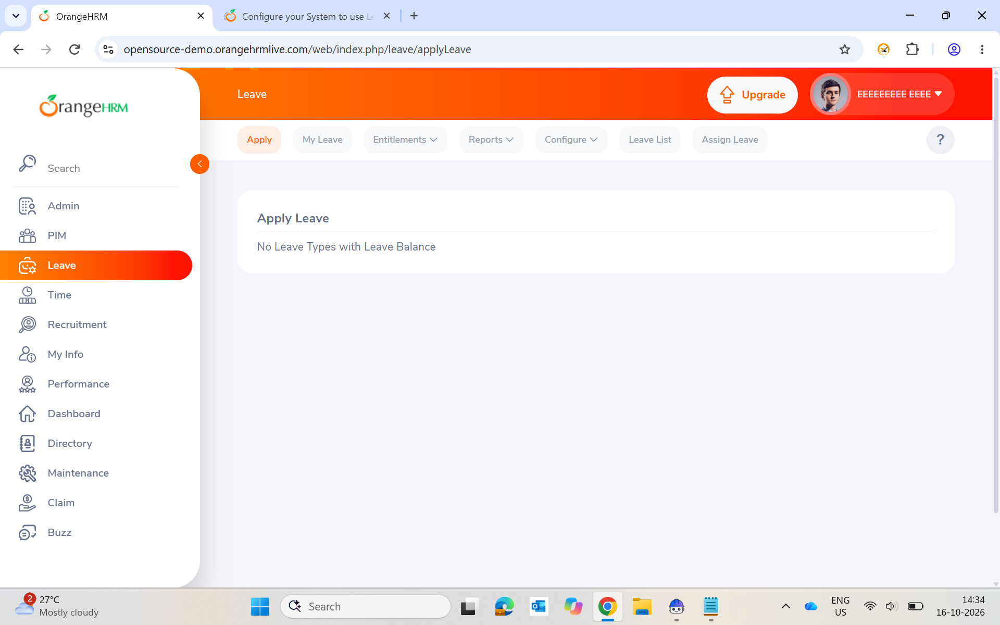
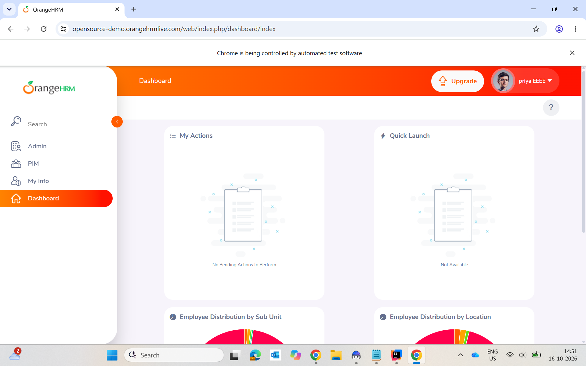
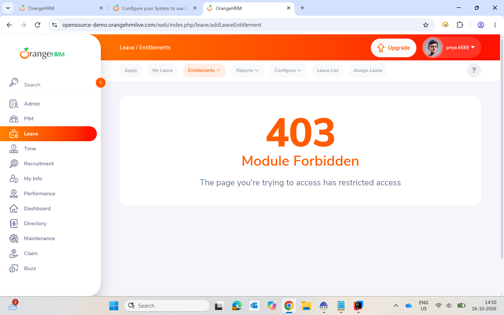
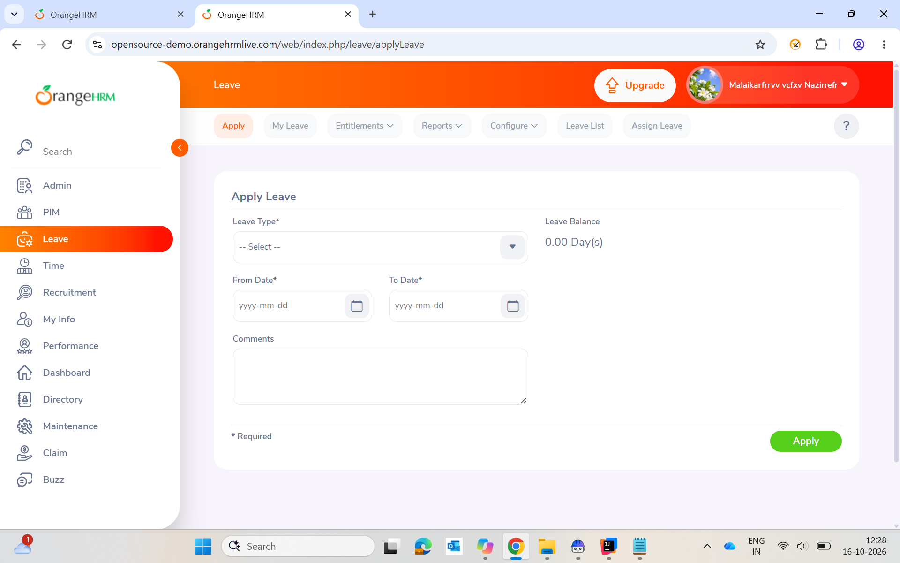
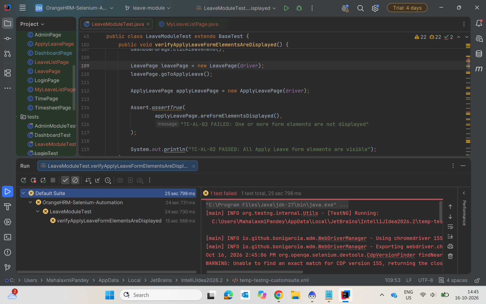
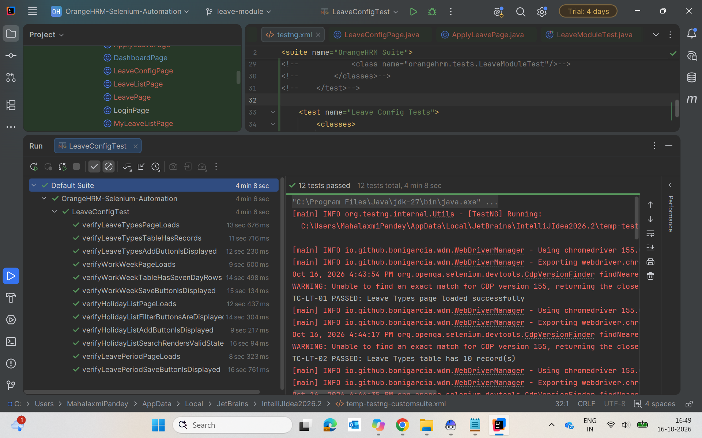
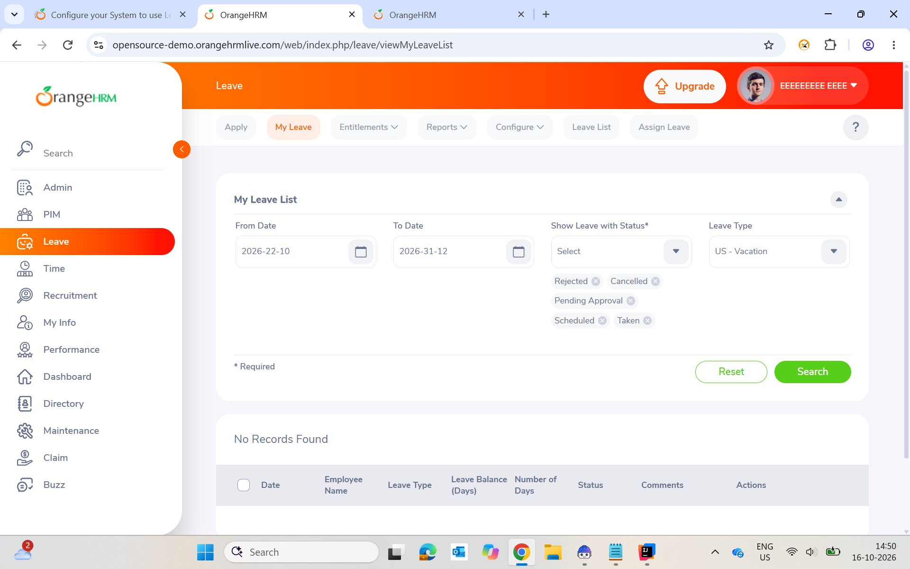
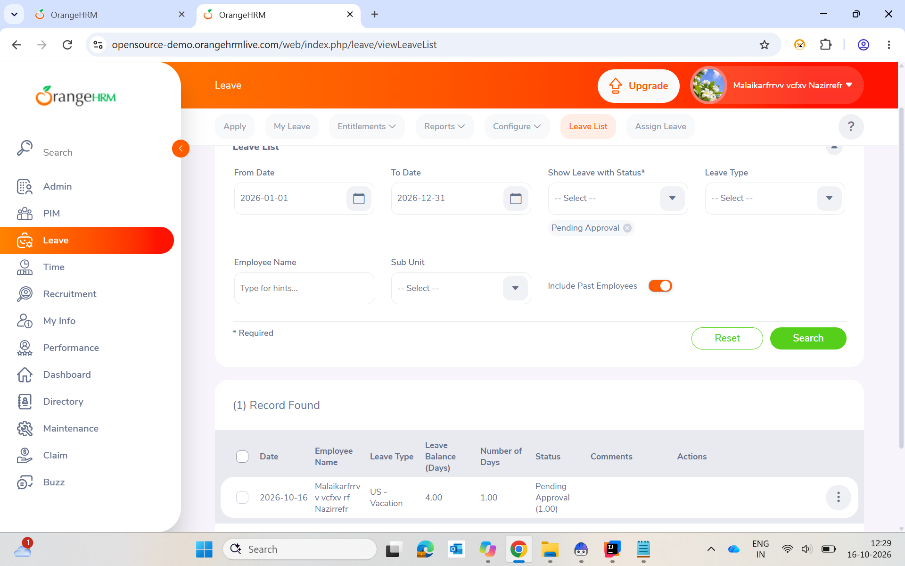

# Defect Report — DEF-LM-001

## Summary

On the shared OrangeHRM public demo site, the account used for testing (Admin / admin123)
intermittently shows a different displayed identity, loses sidebar menus, and loses access
to or data in the Leave module. As a result, Leave module pages return a blank page, a
"403 Module Forbidden" error, or "No Leave Types with Leave Balance", and the Leave
workflow tests become unreliable.

**Cause: not confirmed.** The exact trigger and the interval between changes were not measured.

---

## Defect Details

| Field              | Value                                              |
|--------------------|----------------------------------------------------|
| Defect ID          | DEF-LM-001                                         |
| Module             | Leave Management                                   |
| Severity           | Medium                                             |
| Priority           | Medium                                             |
| Status             | Open                                               |
| Reported By        | Mahalaxmi Pandey                                   |
| Date Reported      | 16-10-2026                                         |
| Application        | OrangeHRM Open Source Demo                         |
| URL                | https://opensource-demo.orangehrmlive.com          |
| Browser            | Google Chrome (latest)                             |
| Credentials Used   | Admin / admin123                                   |
| Automation Stack   | Selenium 4, TestNG 7.10.2, Java 21, Maven          |

---

## Affected Test Cases

All tests in `LeaveModuleTest.java` depend on the Leave module being available, so all
13 can be affected. Those most often seen failing are listed first.

| Test Case ID | Page            | Impact When Defect Occurs                               |
|--------------|-----------------|---------------------------------------------------------|
| TC-AL-01     | Apply Leave     | Page heading not visible / page blank                   |
| TC-AL-02     | Apply Leave     | Form elements absent                                    |
| TC-AL-03     | Apply Leave     | Apply button not found — form not present               |
| TC-AL-04     | Apply Leave     | Success toast not shown — leave type missing or no form |
| TC-ML-01     | My Leave List   | Page heading not visible                                |
| TC-ML-02     | My Leave List   | Search shows records of a different user, or none       |
| TC-ML-03     | My Leave List   | Reset checked against a different user's state          |
| TC-LL-01     | Leave List      | Page unavailable or redirects away                      |
| TC-LL-02     | Leave List      | Employee search returns no results (test data missing)  |
| TC-LL-03     | Leave List      | Unexpected state if the page is unavailable             |
| TC-LL-04     | Leave List      | Pending Approval filter returns empty results           |
| TC-LL-05     | Leave List      | Unexpected state if the page is unavailable             |
| TC-E2E-01    | All three pages | Any step can fail or show data for a different user     |

---

## Preconditions

- User navigates to the OrangeHRM login page
- User logs in with credentials: Admin / admin123
- Dashboard is displayed

> Note: the profile name in the top-right corner is the name of the employee linked to
> the Admin account. It has never read "Admin" in any observed session, so it cannot be
> used to identify the logged-in account.

---

## Steps to Reproduce

1. Open: https://opensource-demo.orangehrmlive.com/web/index.php/auth/login
2. Enter username: `Admin`, password: `admin123` and click Login
3. Confirm the Dashboard is displayed and note the profile name and sidebar menus
4. Click **Leave** in the left sidebar, then click **Apply**
5. Wait without performing any action, and repeat the visit to the Leave pages over time
6. Observe the top-right profile name, the sidebar menus, and the page content

---

## Expected Result

- The Admin account keeps the same displayed identity and sidebar menus (including Leave)
  for the whole session
- The Apply Leave form shows Leave Type, From Date, To Date, Comments and the Apply button
- Leave sub-pages (Apply, My Leave, Leave List, Entitlements) stay accessible with
  Admin-level permissions, and Leave data stays stable between visits

---

## Actual Result

The following outcomes were observed on 16-10-2026 with the same credentials (Admin / admin123):

| # | Observed outcome | Time | Evidence |
|---|------------------|------|----------|
| 1 | The profile name differs between visits and never reads "Admin": "Malaikarfrrvv vcfxv Nazirrefr", then "EEEEEEEEE EEEE", then "priya EEEE" | 12:28 – 14:51 | 01, 02, 03, 04, 07, 08, 09 |
| 2 | Sidebar loses menus: only Admin, PIM, My Info and Dashboard remain; Leave and others are gone. Captured during an automated run ("Chrome is being controlled by automated test software") | 14:51 | 02 |
| 3 | `/leave/addLeaveEntitlement` returns **403 Module Forbidden** | 14:50 | 03 |
| 4 | `/leave/viewMyLeaveList` returns **403 Module Forbidden** | 14:50 | 07 |
| 5 | Apply Leave shows only **"No Leave Types with Leave Balance"** — no form fields | 14:34 | 01 |
| 6 | Apply Leave form renders normally but under a different profile name, with a 0.00 leave balance | 12:28 | 04 |
| 7 | In the same minute (14:50), one browser tab shows 403 as "priya EEEE" while another tab shows My Leave List loading normally as "EEEEEEEEE EEEE" | 14:50 | 07, 08 |
| 8 | The date field format differs between visits: `yyyy-mm-dd` at 12:28, `yyyy-dd-mm` at 14:50 | 12:28, 14:50 | 04, 08 |
| 9 | An automated test fails: `LeaveModuleTest.verifyApplyLeaveFormElementsAreDisplayed` (TC-AL-02) | 14:45 | 05 |

---

## Reproducibility

Intermittent. It does not happen on every visit. **The interval between changes was not
measured** — it is not known how long the site stays in one state before changing. Not
reproducible on a dedicated test instance (not tried for this report; see Recommendation).

The screenshot timestamps from 16-10-2026 give a rough idea of how the state moved
during the day:

| Time  | Profile name shown               | Leave module state                          | Evidence |
|-------|----------------------------------|---------------------------------------------|----------|
| 12:28 | Malaikarfrrvv vcfxv Nazirrefr    | Apply Leave form shown, balance 0.00        | 04       |
| 12:29 | Malaikarfrrvv vcfxv Nazirrefr    | Leave List shows 1 record                   | 09       |
| 14:34 | EEEEEEEEE EEEE                   | Apply Leave: "No Leave Types with Leave Balance" | 01  |
| 14:50 | EEEEEEEEE EEEE                   | My Leave List loads, "No Records Found"     | 08       |
| 14:50 | priya EEEE                       | My Leave List and Entitlements: 403         | 07, 03   |
| 14:51 | priya EEEE                       | Sidebar reduced, no Leave menu              | 02       |

These are single observations, not a measured interval.

---

## Root Cause

**Not confirmed.** The public demo site is shared by many visitors and resets/changes
over time. The observed evidence (changed employee name, removed sidebar menus, no leave
types, 403 on Leave pages, and two browser tabs showing different users in the same
minute) suggests that shared demo data, configuration and module access are being changed
by other users or by the site's own reset process, but this has not been proven.

From a test automation perspective this is an environment stability problem: the same
credentials do not give the same state twice, so user-dependent Leave tests cannot
produce reliable results on this site.

---

## Impact on Test Automation

- **LeaveModuleTest.java** (13 tests) is excluded from the automated suite in
  `testng.xml` (commented out) because of this defect. It can be run manually on demand.
- **LeaveConfigTest.java** (12 tests) covers system configuration pages and is not
  affected. It runs in the suite and passes consistently.
- The issue is environmental and not a defect in the test code.

---

## Tests Unaffected by This Defect

The 12 tests in `LeaveConfigTest.java` pass consistently because they test
system-wide configuration pages that do not depend on the logged-in employee's data:

| Test Case ID | Page         | What It Verifies                  |
|--------------|--------------|-----------------------------------|
| TC-LT-01     | Leave Types  | Page heading visible              |
| TC-LT-02     | Leave Types  | Table has at least one record     |
| TC-LT-03     | Leave Types  | Add button visible                |
| TC-WW-01     | Work Week    | Page heading visible              |
| TC-WW-02     | Work Week    | All 7 day rows rendered           |
| TC-WW-03     | Work Week    | Save button visible               |
| TC-HO-01     | Holiday List | Page heading visible              |
| TC-HO-02     | Holiday List | Search and Reset buttons visible  |
| TC-HO-03     | Holiday List | Add button visible                |
| TC-HO-04     | Holiday List | Search renders a valid state      |
| TC-LP-01     | Leave Period | Page heading visible              |
| TC-LP-02     | Leave Period | Save button visible               |

---

## Mitigation Applied

**`LeaveModuleTest.java`**
- Every test now logs in with `loginAsAdmin()` and opens the Leave menu through a single
  shared helper.
- If the Leave menu is missing after login (the Leave module is unavailable), the test is
  **skipped** (`SkipException`) instead of failed, so an environment problem is not
  reported as a product bug. TC-E2E-01 does the same check before each of its later steps.
- The "My Leave" tab locator in `LeavePage` was corrected (the tab is labelled "My Leave").
- Date fields are now found by their label instead of the placeholder text, because the
  site's date format was seen as both `yyyy-dd-mm` and `yyyy-mm-dd`.
- The two leave-applying tests use different dates so they do not overlap.

**`BaseTest.java`**
- `loginAsAdmin()` waits for the Dashboard heading before any test step.
- `isSessionStillAdmin()` and `ensureAdminSession()` exist but have a **known limitation**:
  `isSessionStillAdmin()` compares the top-right name with "Admin", which never matches,
  so `ensureAdminSession()` always logs in again. They are kept unchanged because other
  test classes use them. `LeaveModuleTest` no longer calls them.

**`testng.xml`**
- `LeaveModuleTest` is commented out of the automated suite. `LeaveConfigTest` remains active.

---

## Recommendation

For reliable automated regression testing of the Leave workflow pages (Apply Leave,
My Leave List, Leave List), use a dedicated OrangeHRM test instance where the account,
menus and Leave data are not changed by other users. The public demo site is not a
suitable environment for automated testing of user-dependent features.

If the public demo must be used, measure how long it stays stable (for example, note the
profile name and sidebar every 5 minutes for 30 minutes) and run the Leave tests inside
a known stable window.

---

## Evidence

All screenshots were taken on 16-10-2026 and are stored in the [`Evidence`](Evidence) folder.
The clock in the bottom-right corner of each screenshot shows the time.

### 01 — Apply Leave shows no form (14:34, user "EEEEEEEEE EEEE")

### 02 — Dashboard with a changed user and a reduced menu (14:51, user "priya EEEE")

### 03 — 403 Module Forbidden on Leave / Entitlements (14:50, user "priya EEEE")

### 04 — Apply Leave form renders, but under a different user (12:28, user "Malaikarfrrvv vcfxv Nazirrefr")

### 05 — `LeaveModuleTest` failing run (14:45)

### 06 — `LeaveConfigTest` 12 tests passed (16:49)

### 07 — 403 Module Forbidden on My Leave List (14:50, user "priya EEEE")

### 08 — My Leave List loads normally in another tab in the same minute (14:50, user "EEEEEEEEE EEEE")

### 09 — Leave List (admin view) with 1 record found (12:29, user "Malaikarfrrvv vcfxv Nazirrefr")

---

*Defect report raised as part of Leave Module test automation — OrangeHRM Selenium Project.*
